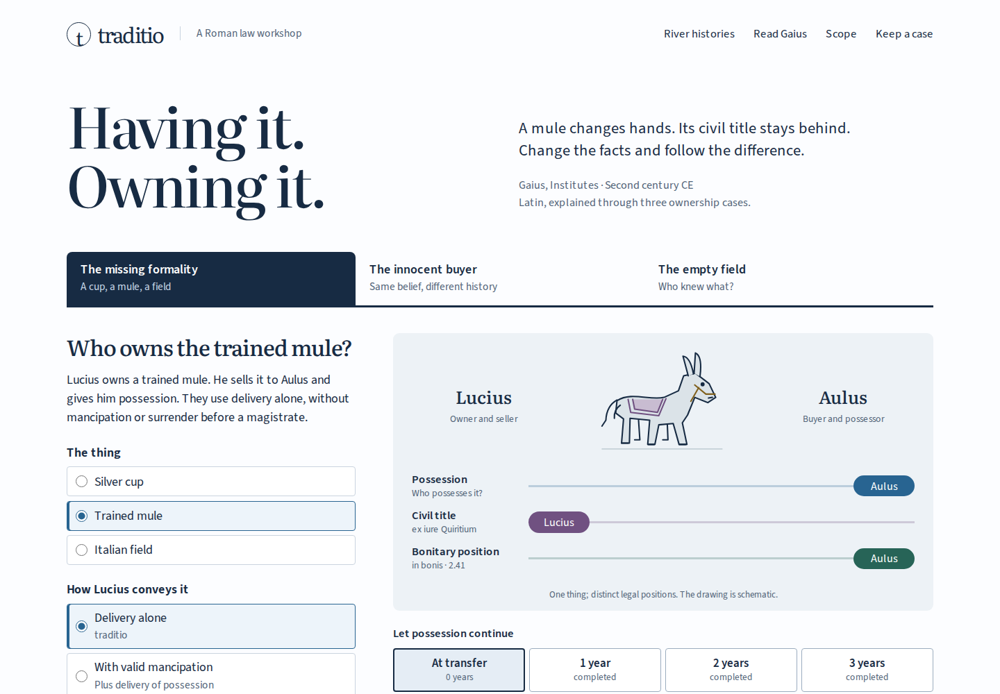

# Traditio

**Change a fact in a Roman ownership case. Follow the title, then read the Latin.**

[](LICENSE)
[](https://antonsoo.github.io/traditio/)



An innocent buyer can possess a stolen cup for years without acquiring its
ownership. Yet an equally innocent buyer of a cup mistakenly sold by a
borrower's heir can acquire it. The buyer's belief is the same; the object's
history changes the result. Gaius makes that distinction in _Institutes_
2.43–50. Traditio lets an English-speaking learner change one premise, see
which legal position changes, and inspect the Latin that does the work.

## Try three investigations

| Investigation         | Change to make                                                                  | What to watch                                                                                             |
| --------------------- | ------------------------------------------------------------------------------- | --------------------------------------------------------------------------------------------------------- |
| The missing formality | Pin the mule at transfer; complete one year                                     | Possession stays with Aulus while civil title moves from Lucius to Aulus                                  |
| The innocent buyer    | Pin the honestly mistaken heir's sale at one year; change the seller to a thief | The same good-faith buyer no longer acquires civil title                                                  |
| The empty field       | Pin peaceful Italian possession after two years; change the entry to force      | The history of the taking blocks this acquisition; a provincial location instead leaves the model's scope |

The first case has three tracks: possession, civil title _ex iure Quiritium_,
and the _in bonis_ position described in 2.41. They are not fractional shares.
The comparison highlights changed premises and distinguishes a one-fact
experiment from a comparison across different investigations.

## Build a counterexample

An agreeing example cannot establish an "always" claim. Choose one of three
deliberately overbroad claims, submit a case that meets its premises, then cite
the passage that defeats its promised conclusion. The exercise distinguishes a
counterexample, a failed premise, an agreeing case and an unresolved scope boundary.

Try "The seller's knowledge bars every buyer." The honestly mistaken heir does
not meet that premise. Marcus's peaceful entry into vacant Italian land does:
he knows it is not his, but a later innocent buyer can acquire by two years'
possession. Read _quamvis_ in 2.51, cite that passage and 2.42, and explain why
the first taker's knowledge does not settle the later buyer's position.

The submission stays fixed while you continue changing the live case. Citations
and a written explanation travel with saved files and explicit shared links.
The software checks facts and source coverage; it does not grade the prose.


Eleven readings pair Latin with new close English and 33 contextual phrase
notes. Select _donec_ to follow "until," _si modo_ to examine a condition, or
_quamquam_ to see why "even though" matters. Nine complete scanned pages from
the 1904 Poste–Whittuck edition retain the printed context, editorial supplies,
textual gaps and old translation. Enlarge a page and pan with the keyboard.

## Rehearse the missing formality

[Who speaks? Who transfers?](https://antonsoo.github.io/traditio/ceremony.html)
opens the assumption behind the first case. Gaius gives acts to particular people:

```text
Mancipation:   acquirer speaks -> strikes balance -> gives that bronze
Before praetor: acquirer claims -> praetor asks -> no counterclaim -> praetor awards
```

Start with four witnesses and a separate balance holder. Try the acquirer's claim,
then add the fifth witness. Count the holder among those five and the arrangement
again misses the text: _praeterea alio_ means another person in addition. Six
witnesses also meet the minimum. An absent mule fails the presence condition;
an absent Italian field is expressly allowed in 1.121.

Before the magistrate, try silence before the question, or an award before the
reply. After a timely silence or disclaimer, title still awaits the award.
A counterclaim leaves the described unopposed procedure; no winner is invented.
The scene shows civil title under stated assumptions and does not assign possession.

Five close readings, phrase notes and four complete pages explain every branch.
The editable record and explicit link retain arrangement, attempts and explanation.
A script-free illustrated rehearsal embeds those facts, the sources, fonts and
licenses, with a native JSON download and printable pages. Undo removes an attempt;
changing the arrangement starts a new sequence while preserving the explanation.

[Source mapping and audit](docs/ceremony-audit.md) ·
[Actual illustrated rehearsal, gzip](docs/ceremony-review/local/rehearsal.html.gz) ·
[Tagged PDF](docs/ceremony-review/local/rehearsal.pdf)

## The bank moved. Did the title?

The local build also includes the **`river.html`** workshop.
This companion follows land, a tree and ownership through a history. Pin the torn
piece at arrival, add roots and long attachment, then return to arrival: later
facts must not rewrite the earlier result. Compare that history with diffuse
alluvion, a tree planted directly in another person's soil, or a flooded field.

| Investigation | What the reader must distinguish                                     |
| ------------- | -------------------------------------------------------------------- |
| Torn piece    | Physical arrival from the later attachment and rooting conditions    |
| Alluvion      | An imperceptible increment from an identifiable piece carried intact |
| Planted tree  | Placement from roots taking hold in the receiving soil               |
| Flooded field | Inundation from a permanent new river channel                        |

The reading selector keeps Gaius's _Institutes_ separate from excerpts attributed
to another Gaian work in the _Digest_ of 533. A short passage's silence is shown
as **Not settled here**, with the last express or stipulated owner separately
identified. It is not treated as a contrary rule or evidence of a dated legal change.

Eight Latin readings, new close English, 23 contextual phrase notes and four
complete printed pages support the histories. Brown roots remain in the carried
piece; new green roots cross into the receiving soil. Long attachment is a distinct
stipulated fact with no invented number of years. Rejected attempts remain visible.
The new workshop is linked from both existing lessons in the local build.

Editable JSON, explicit history links, an every-point comparison CSV, an accessible
SVG and a script-free illustrated HTML reading preserve the work. The retained
[26-page tagged PDF](docs/river-review/local/reading.pdf) was printed from that HTML.
Native downloads still work when the HTML is reopened with scripts disabled.


See the [source mapping, limits and direct browser review](docs/river-audit.md).
This addition is locally verified; its publication is not asserted. After starting
the preview below, open `http://127.0.0.1:4367/traditio/river.html`.

## Run locally

From this checkout, with Node **24 or later**:

```sh
npm ci
npm run check
npm run dev
```

Open `http://127.0.0.1:4368/traditio/`. Development uses a separate origin so an
installed production worker cannot hide your source edits. For a production preview:

```sh
npm run build
npm run preview
```

Open `http://127.0.0.1:4367/traditio/` for the production preview.

`npm run build` produces the complete static site in **`dist/`**, with base
`/traditio/`. There is no server application, account, analytics or upload.
The production edition installs its files for offline reading; the footer
reports readiness after the controlling worker and complete inventory match.
Development mode does not install an offline edition.

## Keep a casebook

| Artifact                  | What it preserves                                                                                                                       |
| ------------------------- | --------------------------------------------------------------------------------------------------------------------------------------- |
| Editable JSON             | Current and pinned facts plus any argument: claim, fixed submission, citations and explanation; outcomes are recomputed                 |
| Explicit case link        | The same facts and argument, including written notes, in the URL fragment; editing controls never rewrites the address bar              |
| SVG diagram               | Current legal positions, visible case facts, source references, original schematic drawing and its accessible description               |
| Illustrated HTML casebook | Cases, comparison, argument, all readings and word notes, nine complete source pages, fonts, licenses and native case/diagram downloads |
| PDF                       | Use Print on the standalone casebook; the retained example was printed in Chromium                                                      |

The casebook captures the cases and argument when Save is pressed. It checks the actual
source, font and license bytes before embedding them. A substituted image,
even with the correct filename and HTTP status, prevents that export.
The HTML contains no JavaScript and makes no asset request when opened.
Preparation can be canceled without losing the work. A source request that
stalls for 20 seconds stops with an error and leaves the case available to retry.
Version 1 case files still reopen; version 2 adds the optional argument. A delayed
import cannot overwrite cases or notes changed while its file was being read.
Ceremony records use their own format and are reopened on the ceremony page.

Actual browser-generated examples:
- [Editable innocent-buyer comparison](examples/mistaken-heir-comparison.json)
- [SVG of the current case](examples/mistaken-heir-comparison.svg)
- [Complete HTML casebook, gzip](examples/mistaken-heir-comparison.html.gz)
- [Tagged, 32-page PDF](examples/mistaken-heir-comparison.pdf)
- [Editable knowing-seller argument](examples/knowing-seller-argument.json)
- [Complete argument casebook, gzip](examples/knowing-seller-argument.html.gz)
- [Printable argument](examples/knowing-seller-argument.pdf)

To reopen the retained HTML:

```sh
gzip -dk examples/mistaken-heir-comparison.html.gz
```

Open `examples/mistaken-heir-comparison.html` in a browser. Its editable-case download reopens through the
workshop's file control; no data is sent anywhere.

## How it works

The pure TypeScript evaluator keeps owner conveyance, non-owner purchase and
the provincial boundary separate. It reports good faith, theft/force and time
as individual conditions, including simultaneous barriers. A non-owner's
good-faith possessor is not silently labeled the bonitary owner of 2.41.

```text
source clause -> chosen facts -> legal positions -> one-fact comparison
      ^                                  |
      +----------- inspect the Latin ----+
```

`src/core/model.ts` handles the bounded rules; `src/core/argument.ts` distinguishes
failed premises from counterexamples and checks citation coverage;
`src/core/record.ts` validates saved facts and links. `src/readings.ts` holds text, translations and contextual
notes. `src/asset-manifest.json` pins the retained file identities. The page
viewer cancels superseded loads and ignores late responses. Exports capture
their inputs before asynchronous file work begins.

The build generates a versioned worker from the complete output inventory.
Installation and readiness use length and SHA-256 checks, not the existence of
a cache alone. Missing or damaged cached files stop the readiness claim; a
connected inventory check repairs them only with matching edition bytes.
An already open edition stays together while a later worker waits to activate.

[Exact source-to-rule mapping and model boundaries](docs/model-and-sources.md) ·
[Retained-file manifest](public/sources/manifest.json) ·
[Font provenance](public/fonts/provenance.json).

The [offline-readiness audit](docs/readiness-audit.md) reproduces and repairs
stale availability claims after source loss, including another open page.
Both failure and verified recovery update every controlled page. Run
`npm run test:readiness` for the independent real-origin audit.

## Verification and limits

`npm run check` runs lint, strict type checking, twenty-two tests, retained-file
verification and the production build. The tests include all 68 supported
configurations against a manually transcribed source-concordance table, record
round trips, counterexamples, invalid premises and distinct legal positions. This checks the code
against that table; it is not independent expert review of Roman law.

With Playwright's Chromium and Firefox available:

```sh
npm run test:browser
npm run test:audit
npm run test:ceremony
npm run test:river
```

The browser review operates the built site at desktop and 375px, including
keyboard controls, comparisons, Latin phrases, actual source-image bytes,
downloads, standalone reopening and accessibility checks. It refuses origin
connections during an actual document reload, then produces the same casebook
offline. It also checks cache loss/recovery, corrupt source refusal, late source
responses and saving while the live case, submitted argument, citations and notes change.
The audit driver adds cancellation, stalled requests, failed installation,
damaged-cache refusal/recovery and the transition between two editions. Screenshots and evidence
are retained in [the review](docs/review.md).

The [original publication review](docs/publication.md) records its historical
22-file edition. The [ceremony audit](docs/ceremony-audit.md) records the current
companion lesson, corrected reading, actual artifacts and publication checks. To repeat that
comparison with a matching local build, run `npm run test:public`.

These are invented cases within Gaius's second-century account. They assume
capable Roman citizens, valid transactions and uninterrupted possession.
They do not decide litigation, all possessory remedies, exceptional usucapion,
provincial private rights or Justinian's later law. Whole years are instructional
steps, not historical date arithmetic. Source scans preserve the ancient
system's enslavement and unequal status; the interactive cases use objects and
land. The diagram is modern and schematic.

## Sources

The primary evidence is [Gaius in the 1904 Poste–Whittuck edition](https://archive.org/details/gaiinstitutiones00gaiuuoft).
The [Roman Law Library's Poste transcription](https://droitromain.univ-grenoble-alpes.fr/Anglica/gai2_Poste.htm)
and [Latin Library text](https://www.thelatinlibrary.com/gaius2.html) supplied
independent comparisons. The printed edition's restorations are marked; its
English is distinct from this workshop's translations. See the
[source notice](public/sources/NOTICE.txt).

## Contributing and license

[Contributing](CONTRIBUTING.md) describes the source and browser review process.
Code, original drawings and new translations are [MIT](LICENSE).
The historical text and page images are public domain. Literata and Source
Sans 3 retain their SIL Open Font Licenses under `public/fonts/`.
