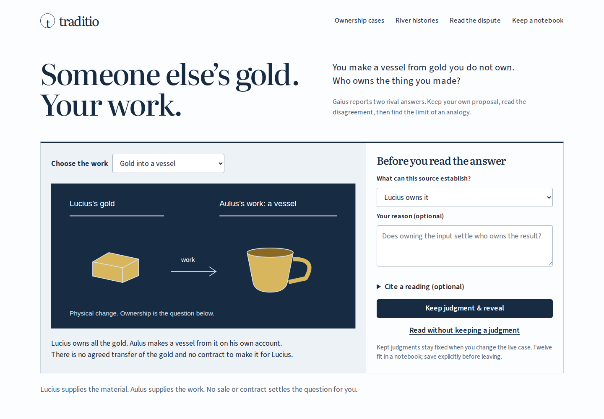

# Craft dispute: local review, 2026-11-03

This is a new fourth room in the existing Traditio repository, not a new project.
It turns Gaius's ownership disagreement into a learner-operated investigation:
keep a proposal, read the rival answers, then test a generalization against an
awkward neighboring example. The new edition has not been pushed or published.
The existing live site is a separate, earlier publication.

## What changed

- Six craft cases distinguish a reported rule, rival answers and an undecided
  analogy. Writing and painting expose opposite directions of accession.
- Twelve kept judgments stay fixed while six independent per-craft drafts remain
  editable. Reasons, chosen citations and an account of the analogy travel in
  JSON, explicit links and a standalone illustrated notebook.
- Seven Latin/English readings, 21 contextual notes and two complete scanned
  pages expose the source's own reservation, restorations and surrounding text.
- Ownership, physical possession and remedies remain separate. The remedy reading
  follows the case; manufacture by itself is never treated as proof of theft.
- The original diagrams rearrange vertically on phones. All four rooms share the
  complete integrity-checked offline edition and edition-recovery notice.

The [model and source decisions](craft-model.md) contain the manually checked
outcome table and explain precisely what is omitted. The [source notice](../public/sources/work-NOTICE.txt)
identifies the edition and the complete retained pages.

## Reproduce

Node 24.22.1 was used for the clean installation, type checking, tests and build.
Playwright 1.63.0 used its installed Chromium and Firefox. Poppler tools inspect
the actual Chromium PDF. The local environment is WSL2 Linux.

```sh
npm ci
npm run check
npm run test:craft
```

The check runs lint, strict TypeScript, 30 tests, retained-file verification and
`npm run build`. Build output is **`dist/`**, with base `/traditio/`. Preview with
`npm run preview`, then open `http://127.0.0.1:4367/traditio/work.html`.
Development uses `npm run dev` at port 4368; it does not install a worker.

Additional operated checks:

```sh
npm run test:readiness
npm run test:upgrade
```

The craft driver writes to `test-results/craft` by default. It uses real
browser downloads rather than generating a supposed example separately.
The retained [browser receipt](craft-review/browser.json) describes four
journeys: Chromium/Firefox at 1440px and 375px, with zero runtime errors and
zero axe violations in the operated view. Each journey checks:
1. Navigation from ownership cases into the new room, keyboard submission,
   fixed judgments, independent drafts, the two general-rule comparisons,
   source phrases and keyboard panning of the enlarged page.
2. Actual displayed source-image hashes, not just successful HTTP requests.
3. JSON restoration, unsupported-version refusal, share-link restoration,
   an unavailable-clipboard fallback and real HTML downloads.
4. Both embedded JPEGs and fonts against the retained manifest; a downloaded
   reading opened from disk with scripts disabled and the browser offline,
   including its own native editable-JSON download.
5. Reload after worker takeover, both source pages, notebook export and
   navigation to all four rooms while the browser is offline.

Both browsers also reject same-length source corruption for display and export,
recover on retry, reject superseded source responses, preserve an export's
click-time record during later edits, cancel without a download, preserve newer
drafts during delayed import and escape learner markup in live/saved notebooks.
These are targeted checks of the actual learner workflow, not a general legal
or security certification.

The [readiness receipt](craft-review/readiness.json) covers all four rooms in
both browsers, with two simultaneous pages, damaged cached files, a real stopped
origin, automatic withdrawal of stale readiness, coalesced repeated failure
messages and verified recovery without losing explanations. Firefox can sometimes
serve valid default-cache bytes during emulated offline mode; the real-origin
outage is recorded separately rather than pretending those are the same check.

The [upgrade receipt](craft-review/upgrade.json) uses a generated **two-room
fixture**, not a claimed replay of exact older hosted bytes. With the old clients
open, both new rooms offer current editable-work downloads. After releasing the
old edition, all four record formats restore. Craft and river readings can then
be downloaded with the origin stopped. Chromium and Firefox differ in whether
the new page is controlled at first opening; both paths were exercised.

## Inspect the result



[Phone view at 375px](assets/craft-375.png).
The interface retains Traditio's cool casebook palette; the gold is an actual
input material. The work surface is the visual focus. On phones it becomes a
vertical input/work/result sequence with readable labels. Screenshots were
opened and inspected. The source reader's scroll viewport shows original full
pixels when enlarged; its default view fits width, not the entire page's height.
- [Illustrated notebook, gzip](craft-review/notebook.html.gz)
- [Actual 26-page tagged Chromium PDF](craft-review/notebook.pdf)
- [Editable notebook](craft-review/notebook.json)
- [Artifact byte identities](craft-review/artifacts.json)

The example keeps an initial material-owner proposal, then a revised account of
the source's disagreement; both remain visible. The PDF includes the complete
source pages on separate sheets, plus full notices and licenses. Both source
sheets were visually inspected. Decompress the HTML before opening it.

## Boundaries

The clause-to-rule mapping and new English have not had independent specialist
review. The source is an edited 1904 witness to Gaius, not an ancient manuscript.
The room does not infer philosophical affiliations, supply a later compromise,
adjudicate repair or calculate recovery expenses. It has explicit saves, with
no background persistence; leaving the page requires saving the notebook first.
The shared source loader retains the existing 20-second per-file deadline.

Local source, build, downloads and browser behavior were checked separately.
No new remote source head, hosted bytes, public route or CI run is claimed.
