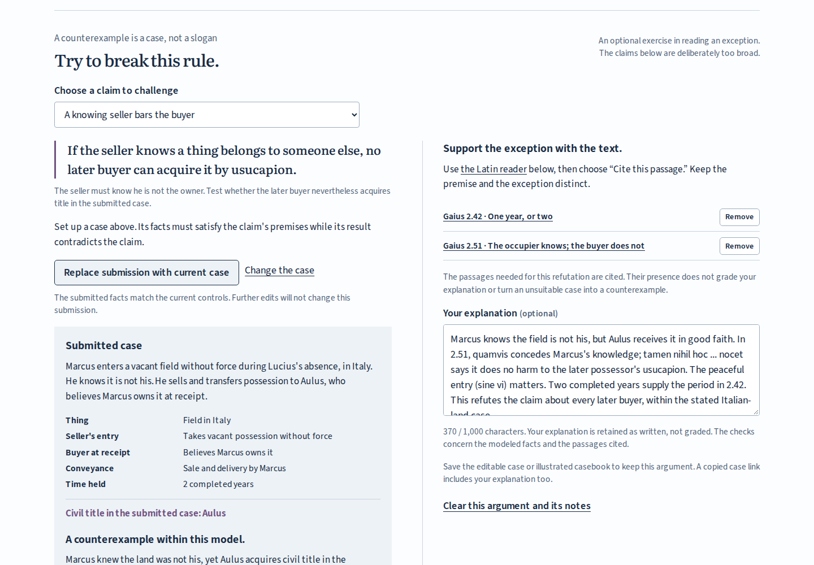

# Traditio: counterexamples, sources and portable arguments

Reviewed on 2026-10-29. Application commit
`e016ae30a6be62fdc28f6bc047aae481a3a6adfb` was built from a fresh archive and
operated in both browsers. This page records the local audit and learner work;
public delivery is a separate review, not implied by a successful build.

## Try the actual work

1. Open the workshop and choose **The empty field**. Keep Italy, peaceful entry
   and the buyer's good faith. Advance to **2 years** and pin the case.
2. Under **Try to break this rule**, choose **A knowing seller bars the buyer**
   and submit the current case. Marcus's knowledge meets the claim's premise,
   yet Aulus acquires. This is a counterexample within the stated model.
3. Read **2.51**, select _quamvis_, and cite the passage. Then cite **2.42** for
   the two-year period. Add an explanation distinguishing the first occupier
   from the later buyer.
4. Change Marcus's entry to **force** in the live controls. The live title
   changes to Lucius; the submitted peaceful case and its argument stay fixed.
   The comparison pin shows that only entry changed.
5. Save the illustrated casebook and editable case. Reopen the HTML on its own,
   follow its source links within the document, and use its native JSON download
   to reopen the argument in the workshop.

The [editable example](../examples/knowing-seller-argument.json),
[self-contained HTML, compressed](../examples/knowing-seller-argument.html.gz),
and [34-page tagged PDF](../examples/knowing-seller-argument.pdf) retain that
actual browser-operated workflow. The argument remains attached to the submitted
case, not whichever controls happen to be visible later.

The other two claims concern immediate title after an owner's delivery and
whether good faith plus elapsed time suffice after a non-owner's sale. The
exercise rejects a bad-faith buyer, an incomplete period or an honestly mistaken
seller when those facts fail the chosen premise. Provincial land remains outside
the title model. Citation coverage is separate from the factual assessment;
the learner's explanation is saved as written and is not graded.

## What the audit repaired

Four defects were reproduced before editing: the preview worker could hide
development changes on a shared origin; a stalled export had no cancellation or
deadline; two exported figures shared accessible-description IDs; and a failed
initial installation could leave the footer saying "Preparing" indefinitely.

The fixes include separate development/preview ports, cancellation and bounded
source requests, distinct descriptions for every figure and explicit failed
installation feedback. Cached files are checked before serving, and a damaged
or missing file is repaired only with exact edition bytes. The standalone SVG
now shows the case facts visibly, rather than only in its accessible description.

[Before/after receipts and reproduction commands](../studies/audit-2026-10-29/README.md)
keep those findings separate from the new feature and from publication.

## Build and source evidence

An archive of the application commit was unpacked into an empty directory.
Node **24.22.1**, npm **11.19.1**, Linux x64, `npm ci` and `npm run check`
completed successfully. All **22** production files matched the browser-reviewed
build byte for byte. The worker's edition `e9b21d2df854b7b3c9b4` contains
**21 files, 7,122,127 bytes**; the worker script is the remaining build file.

The twelve tests cover all **68 supported configurations** against a manually
transcribed source-concordance table, counterexample premises, independent
citation coverage, record versions 1 and 2, invalid inputs and copied snapshots.
Fifteen retained source, font and license files matched their SHA-256 identities.
This checks the implementation against the author's reading; it is not independent
expert review of Roman law. See [the source mapping](model-and-sources.md).

The documented `npm run dev` and `npm run preview` were also operated in the
same browser context in each engine. Preview remained worker-controlled while
development loaded its live source module and installed no worker. The two
processes were stopped afterward.

## Browser and artifact evidence

| Browser                | Viewports               | Cases, comparisons, Latin and actual scans | Counterexamples, citations and editable arguments | Standalone HTML and offline export |
| ---------------------- | ----------------------- | ------------------------------------------ | ------------------------------------------------- | ---------------------------------- |
| Chromium 153.0.8010.12 | 1440 x 1000; 375 x 1000 | Passed                                     | Passed                                            | Passed                             |
| Firefox 155.0          | 1440 x 1000; 375 x 1000 | Passed                                     | Passed                                            | Passed                             |

`npm run test:browser` operates real controls, including keyboard actions,
Latin word notes, enlarged-page panning and each of the nine source scans.
It hashes the actual image Blobs supplied to the viewer. Browser downloads
produce JSON, SVG and HTML; standalone HTML opens by file URL, loads all retained
images and fonts without HTTP requests, and downloads its matching native JSON.

The argument journey constructs all three kinds of counterexample, rejects
false premises and the provincial boundary, removes and restores citations,
preserves a fixed submission while the live case changes, round-trips both
file versions and shared links, and rejects a malformed argument without losing
the existing work. Literal HTML in a learner's note stays text.

For offline review, the local origin refuses TCP connections while the browser
performs an actual reload. Both comparison and argument casebooks exported
offline match their online versions byte for byte. Removing a cached scan stops
the readiness claim; reconnecting repairs the exact file. A separate delayed
export captures the click-time case, witness, citations and explanation despite
later edits to all four.

The four journeys report no page/console errors and no external asset requests.
Axe reports zero violations for its WCAG 2/2.1 A/AA tags on the base workshop and
expanded argument. This is not a substitute for assistive-technology testing.

`npm run test:audit` adds first-install failure/recovery, damaged-cache refusal,
exact-byte refill, old/new edition transition, cancellation, timeout, retry and
each figure's accessible-description ownership in both engines.

The **32-page** comparison and **34-page** argument PDFs were printed from the
actual standalone downloads. Both are tagged and contain no JavaScript. Argument
pages 3, 4, 5 and 24 were rendered and inspected for comparison layout, the claim,
submitted facts, explanation and complete source-page placement. Extracting its
nine JPEGs reproduced all nine retained source files byte for byte.

| Evidence                                                   | Receipt                                                                                    |
| ---------------------------------------------------------- | ------------------------------------------------------------------------------------------ |
| Exact build and retained artifact identities               | [artifact-review.json](artifact-review.json)                                               |
| Four browser journeys and two source-fault journeys        | [browser-review.json](browser-review.json)                                                 |
| Cancellation, installation, cache and edition faults       | [after-browser-audit.json](../studies/audit-2026-10-29/after-browser-audit.json)           |
| Shared browser context with separate dev/preview origins   | [after-development-origin.json](../studies/audit-2026-10-29/after-development-origin.json) |
| Text bounds for all 68 standalone diagrams in both engines | [after-diagram-geometry.json](../studies/audit-2026-10-29/after-diagram-geometry.json)     |

All retained screenshots were opened and inspected. The argument is one ruled
worksheet on desktop and a sequential claim, submission and evidence sheet on
phones. The longer comparison and source material require scrolling; the page
viewer preserves the entire scan and supports magnification.

| State        | Chromium desktop                           | Chromium phone                            | Firefox desktop                           | Firefox phone                            |
| ------------ | ------------------------------------------ | ----------------------------------------- | ----------------------------------------- | ---------------------------------------- |
| Argument     | [Image](assets/argument-chromium-1440.png) | [Image](assets/argument-chromium-375.png) | [Image](assets/argument-firefox-1440.png) | [Image](assets/argument-firefox-375.png) |
| Latin reader | [Image](assets/reading-chromium-1440.png)  | [Image](assets/reading-chromium-375.png)  | [Image](assets/reading-firefox-1440.png)  | [Image](assets/reading-firefox-375.png)  |

## Boundaries

These are invented cases within Gaius's second-century account, with capable
parties, valid sales and uninterrupted possession. The workshop does not decide
litigation or every possessory remedy, model exceptional usucapion, assign
provincial private title, or substitute later Justinianic periods. The source
edition and its marked restorations remain distinct from the ancient author,
the new translations and the executable interpretation.

Source evidence, clean output, browser behavior, downloadable artifacts, remote
CI and public delivery are separate claims. The initial local review is retained
in Git history at `85453db`; it is superseded by the evidence above.
