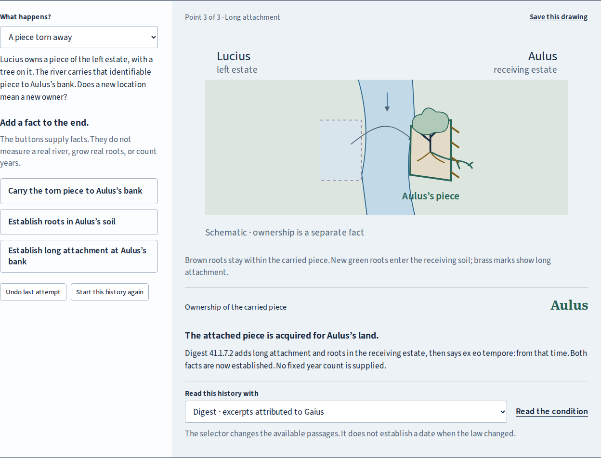
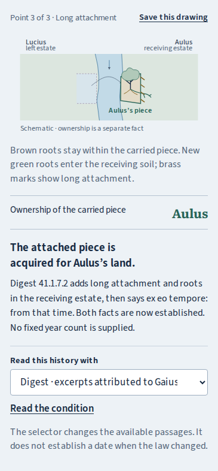

# River histories: source mapping and direct review

The new `river.html` companion makes a distinction that a picture of the present
cannot settle: a bank can gain land without the receiving landowner acquiring
an identifiable piece carried there. The learner keeps the history and inspects
the Latin condition, rather than inferring ownership from the object's location.

This is a local addition. No push, deployment or remote-CI result is asserted.
Build with `npm run build`; the complete static edition is `dist/`. With
`npm run preview`, open `http://127.0.0.1:4367/traditio/river.html`.
Both existing lessons link to it in this build.

## Try the actual work

1. The initial piece has arrived at Aulus's bank. Ownership still reads **Lucius**.
   Pin this point, then establish roots in Aulus's soil. With the short Institutes
   reading selected, the later history is **Not settled here**. The last express
   owner is shown separately.
2. Choose the Digest reading. Roots alone have not established its two stated
   attachment conditions. Establish long attachment: the model now reports Aulus.
   Select point 1 in the history: ownership returns to Lucius while the later
   facts remain recorded. The original arrival is not retroactively relabelled.
3. Choose imperceptible accretion and establish the addition. The same outlined
   footprint now belongs to Aulus through a different material history. The
   comparison identifies the different investigation, rather than calling this
   the same object or a one-fact legal experiment.
4. For the tree, try roots before planting; then plant and establish roots again.
   Only the roots in the receiving soil meet the condition. For the flood, try
   recession before flooding; the Digest reading preserves Aulus's field through
   the flood and recession. A permanent new river channel is not supplied.
5. Follow **Read the condition**, operate the Latin phrase buttons, enlarge and
   pan the whole source page. Save the histories and illustrated reading. Reopen
   the reading on its own with JavaScript disabled; its native editable-history
   download reopens in the workshop.



## What the texts say, and what the model supplies

| Reading                   | Relevant wording or distinction                                                                         | Model use                                                                                                                                  |
| ------------------------- | ------------------------------------------------------------------------------------------------------- | ------------------------------------------------------------------------------------------------------------------------------------------ |
| Gaius, Institutes 2.70    | _ita paulatim_, _quoquo momento temporis_, _ut oculos nostros fallat_                                   | Imperceptibility at each moment is stipulated; the eventual outlined addition belongs to the receiving estate's owner                      |
| Gaius, Institutes 2.71    | _ex tuo … ad meum_, _haec pars tua manet_                                                               | The identifiable carried piece remains Lucius's at arrival; later attachment questions are not settled by this selected paragraph          |
| Gaius, Institutes 2.73–74 | _superficies solo cedit_, _si modo radicibus terram conplexa fuerit_                                    | The preceding soil rule gives the antecedent for the plant sentence; the transplanted tree follows Aulus's soil once roots take hold there |
| Digest 41.1.7.1           | Gradual addition, expressed with _intellegere non possimus_                                             | The same stipulated alluvion case has an express source under this reading                                                                 |
| Digest 41.1.7.2           | Arrival preserves title; _longiore tempore … haeserit_, _arboresque … radices egerint_, _ex eo tempore_ | Long attachment and new roots are separate facts; the described acquisition is established when both are present after arrival             |
| Digest 41.1.7.13, opening | _antequam … radices ageret, illius permanet, cuius et fuit_                                             | Expressly identifies the planted tree's former owner before rooting; later boundary-spanning roots are outside this model                  |
| Digest 41.1.7.6           | _inundatio speciem fundi non mutat_; the field belongs to the same person when water recedes            | Inundation preserves the stipulated estate's identity; the neighbouring new-channel discussion is not applied to it                        |

The Institutes are Gaius's second-century textbook. The Digest is a compilation
of 533 CE, and its fragment heading attributes 41.1.7 to book two of Gaius's
_Res cottidianae sive aurea_, a different work. The reading selector means
**which passages are available as evidence**, not a switch between dates when
the law allegedly changed. The attribution does not settle authorship,
interpolation or transmission. The app neither invents a contradiction nor
turns silence into perpetual title.

The selected Digest continuation describes long attachment and the carried
trees putting down roots. The evaluator requires both, in either order after
arrival. It does not claim that every other form of union is legally ineffective.
No year count, hydrological threshold, treeless-piece rule, real surveyed
boundary, disputed-fact decision, compensation or remedy is computed.

The explicit starting facts exclude other conveyances, usucapion and competing
rights. The estates are ordinary private river-bounded land. Fixed-boundary
allotments, islands, abandoned beds, permanent new channels, shared roots and
removal after accession are outside the model. The source scans retain adjacent
material, including Gaius 2.76 on expenses and the defence of fraud; title alone
does not decide an action for recovery.

## Retained editions

| Printed pages | Retained edition                                                                                                    | Digitized evidence                                                                                                                                                           |
| ------------- | ------------------------------------------------------------------------------------------------------------------- | ---------------------------------------------------------------------------------------------------------------------------------------------------------------------------- |
| 160–161       | Gaius, _Gai Institutiones_, Poste's Latin/English edition, revised by E. A. Whittuck, Oxford: Clarendon Press, 1904 | [Page 160](https://archive.org/details/gaiinstitutiones00gaiuuoft/page/n223/mode/1up), [page 161](https://archive.org/details/gaiinstitutiones00gaiuuoft/page/n224/mode/1up) |
| 644–645       | _Corpus Iuris Civilis_ I, sixth stereotype edition; Digest edited by Theodor Mommsen, Berlin: Weidmann, 1893        | [Page 644](https://archive.org/details/corpusiuriscivil00krueuoft/page/n759/mode/1up), [page 645](https://archive.org/details/corpusiuriscivil00krueuoft/page/n760/mode/1up) |

The Corpus title page visibly prints **MDCCCXCIII**, despite the Archive's
catalogue date field of 1892. Its OCR page-number JSON identifies leafNum
760/761, but the image endpoint needs n759/760. The actual page numbers and Latin
were inspected in the images. The Gaian image endpoint uses printed page + 63.
No source image was cropped, retouched or generated.

The readings join line breaks, print consonantal u as v, and retain the printed
_adluvionem_ and _conplexa_. The new English and 23 phrase notes are original
teaching material. They are distinct from Poste's English and have not received
independent philological or legal-historical review. The tree passage from the
Digest is expressly marked as an opening excerpt; its complete printed page
retains the continuation.

Independent comparison: [Institutes Latin](https://www.thelatinlibrary.com/gaius2.html),
[Poste English](https://droitromain.univ-grenoble-alpes.fr/Anglica/gai2_Poste.htm),
[Digest Latin based on Mommsen](https://droitromain.univ-grenoble-alpes.fr/Corpus/d-41.htm).
The [source notice](../public/sources/NOTICE.txt) and identical private/public
manifests retain exact download URLs, byte lengths and SHA-256 values.

## Implementation boundaries

`src/core/river.ts` separates physical replay from source-bounded evaluation.
Rejected or repeated attempts remain in the history but change no physical fact.
Rooting or attachment attempted before arrival cannot be banked for later.
Moving the inspected point applies only that prefix; appending adds at the end.
Undo removes one attempt. Changing investigation starts a new history while
keeping the pinned history and explanation. Changing the reading changes no
physical fact.

The full current and pinned histories, their inspected points and the explanation
are the portable record. No verdict is trusted on import. Native files and
explicit links use the same validator; invalid files keep the current work.
A delayed import cannot overwrite a newer fact, selected point, comparison or
explanation. State is not automatically saved between visits.

The drawn roots were visually checked: brown roots stay inside the carried
piece; new green roots cross its boundary into the receiving estate. Brass
hatching represents the separate long-attachment fact. Colours also have text
labels. SVG accessible descriptions state the facts, source selection and result.

Illustrated export captures the record before asynchronous reads. It verifies
actual source, font and licence bytes, supports cancellation, and uses the shared
20-second request deadline. The standalone HTML contains no script and makes no
asset request. Its native JSON, CSV and SVG anchors work without JavaScript.
The every-point CSV includes whether each point is the inspected one and its
source passage, including refused attempts and later facts still in the record.
Its native CRLF bytes are preserved by Git. The browser review regenerates the
artifact receipt and checks printed word margins; `verify:sources` also verifies
all five retained native artifacts against that receipt.

Adding the second edition exposed a shared-manifest integration hazard: the
ownership reader and casebook used every file with a printed-page number, then
labelled them all as Poste–Whittuck pages. They now use the explicit ownership
source set in `src/source-sets.json`. This retains the original nine-page reader
and prevents the new Digest images from acquiring false captions or filenames.

## Direct verification

Run from the repository with Node 24+, Python 3/Poppler for PDF inspection, and
Playwright's Chromium and Firefox available:

```sh
npm ci
npm run check
npm run test:river
npm run test:readiness
npm run test:browser
node scripts/ceremony-review.mjs http://127.0.0.1:4367/traditio/ test-results/ceremony
```

The ceremony command requires a production preview on its supplied origin.
The other browser drivers start their own ephemeral origin. These commands
exercise controls and genuine downloads; test counts alone are not a delivery
claim. The six new core tests include an 18-row, manually transcribed concordance
under both readings, rejected fact sequences, earlier-point replay, hostile
records and portable data. This is agreement with that concordance, not external
expert review of Roman law.

| Evidence                                                       | Observed boundary                                                                                                                                                                                                                                                                    |
| -------------------------------------------------------------- | ------------------------------------------------------------------------------------------------------------------------------------------------------------------------------------------------------------------------------------------------------------------------------------ |
| [River browser receipt](river-review/local/report.json)        | Chromium and Firefox, 1440px and 375px; all four page identities and all 23 phrases; keyboard facts and timeline; comparison; JSON/CSV/SVG/HTML; script-disabled standalone reopening; explicit link and file round trips; no runtime errors or axe violations in the reviewed state |
| Same receipt, faults                                           | A same-length substituted JPEG is refused for display and export; verified retry succeeds; edits during export cannot change the captured record; cancellation and delayed-import preservation work                                                                                  |
| [Readiness receipt](river-review/readiness.json)               | All three lessons in both browsers; real stopped-origin failures, refusal of a matching source from another edition, automatic invalidation/recovery in another open lesson, coalesced notices, and held/activated edition transitions                                               |
| [Ownership regression](river-review/ownership-regression.json) | Both browsers and sizes still operate the original ownership cases, nine-page reader, arguments, native exports and offline reload                                                                                                                                                   |
| [Ceremony regression](river-review/ceremony-regression.json)   | Both browsers and sizes still operate the formal acts, source reader, portable rehearsal and offline reload; race and failure cases remain covered                                                                                                                                   |
| [Artifact receipt](river-review/artifacts.json)                | Native file byte counts and hashes; the tagged PDF has 26 pages and 5,112 extracted words, with no extracted word outside a 35-point inset                                                                                                                                           |



The source reader, comparison, mobile result and standalone document were
visually inspected. The layout has legible ordinary-text facts, no horizontal
document overflow at the reviewed phone size, and distinct marks for original
roots, receiving-soil roots and long attachment. Small diagram labels supplement
the full text account. No physical printer or general PDF accessibility
certification is claimed.

Actual native outputs: [histories](river-review/local/histories.json),
[every-point CSV](river-review/local/histories.csv),
[SVG](river-review/local/history.svg),
[complete HTML, gzip](river-review/local/reading.html.gz),
[tagged PDF](river-review/local/reading.pdf).
To reopen the HTML without the app:

```sh
gzip -dc docs/river-review/local/reading.html.gz > /tmp/traditio-river-reading.html
```

The complete production build uses base `/traditio/`; its offline inventory is
generated from its output files. Hosted bytes, remote source synchronization,
remote CI and public catalogue discovery have not been verified for this local
addition. No external publication action was taken.

Suggested repository description: **Read Roman ownership through changing facts,
Latin sources and visual histories.** Topics: `roman-law`, `latin`, `gaius`,
`legal-history`, `education`, `interactive-learning`, `offline-first`.
